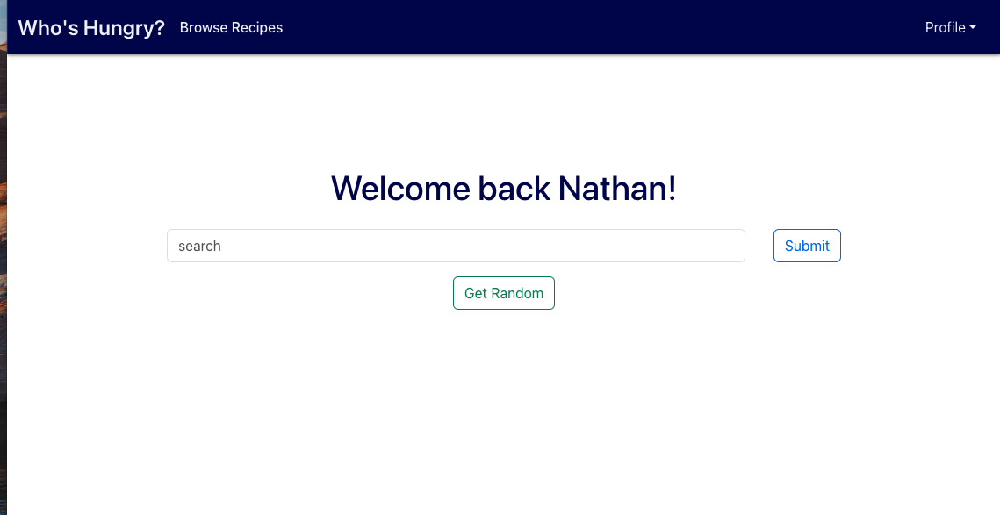

<a id="readme-top"></a>

[![Stargazers][stars-shield]][stars-url]
[![LinkedIn][linkedin-shield]][linkedin-url]

<!-- PROJECT TITLE -->
<div align="center">
  <h2 align="center">Who's Hungry?</h2>

  <p align="center">
    A full-stack recipe discovery app: search thousands of recipes, browse by cuisine, and save your favorites to a personal account.
    <br />
    <a href="#getting-started"><strong>Run it locally »</strong></a>
    <!-- Add this once deployed: · <a href="LIVE_DEMO_URL">View live demo</a> -->
  </p>
</div>

<!-- SCREENSHOT -->
<div align="center">

<!-- Replace with a real screenshot of the running app, e.g. images/whos-hungry-home.png -->


</div>

<!-- TABLE OF CONTENTS -->
<details>
  <summary>Table of Contents</summary>
  <ol>
    <li>
      <a href="#about-the-project">About The Project</a>
      <ul>
        <li><a href="#features">Features</a></li>
        <li><a href="#built-with">Built With</a></li>
      </ul>
    </li>
    <li><a href="#getting-started">Getting Started</a></li>
    <li><a href="#roadmap">Roadmap</a></li>
    <li><a href="#contact">Contact</a></li>
  </ol>
</details>

<!-- ABOUT THE PROJECT -->
## About The Project

Who's Hungry? is a full-stack web application built as the capstone for my Software Engineering Certificate at Gonzaga University. It demonstrates an end-to-end stack: a React front end, an Express/Node REST API, PostgreSQL persistence, token-based user authentication, third-party API integration with [Spoonacular][Spoonacular-url], and a tested backend.

The app lets users search a large recipe database, browse by cuisine, create an account, and save recipes to return to later.

<p align="right">(<a href="#readme-top">back to top</a>)</p>

### Features

* Search recipes from the Spoonacular API
* Browse recipes by cuisine type
* Create a user account with secure authentication
* Save recipes to your profile

<p align="right">(<a href="#readme-top">back to top</a>)</p>

### Built With

* [React.js][React-url]
* [Node.js][Nodejs-url]
* [Express.js][Express-url]
* [PostgreSQL][Postgres-url]
* [Bootstrap][Bootstrap-url]
* [Spoonacular API][Spoonacular-url]

<p align="right">(<a href="#readme-top">back to top</a>)</p>

<!-- GETTING STARTED -->
## Getting Started

To run the project locally, you'll need Node.js and PostgreSQL installed, plus a free Spoonacular API key.

### 1. Clone the repository

```sh
git clone https://github.com/natesmith21/whos-hungry.git
cd whos-hungry
```

### 2. Set up the backend

```sh
cd backend
npm i
```

Create a `.env` file in the `backend` folder. Get a free API key by signing up at [Spoonacular][Spoonacular-url]:

```
NODE_ENV=test
SECRET_KEY=[your_secret_key]
BASE_URL=https://api.spoonacular.com
API_KEY=[your_api_key]
```

### 3. Seed the database

```sh
psql -f whos_hungry.sql
```

### 4. Start the backend

```sh
npm run dev
```

### 5. Run the tests (optional)

```sh
npm test
```

### 6. Set up and start the frontend

```sh
cd ../frontend
npm i
npm run dev
```

The app will be available at http://localhost:5173

<p align="right">(<a href="#readme-top">back to top</a>)</p>

<!-- ROADMAP -->
## Roadmap

The database schema already includes fields for rating recipes and tracking which ones a user has made. Planned enhancements:

* [ ] Let users rate and mark recipes as "made"
* [ ] User-uploaded recipes
* [ ] More robust browse / filter / sort
* [ ] Comments on recipes
* [ ] Connect users as friends

<p align="right">(<a href="#readme-top">back to top</a>)</p>

<!-- CONTACT -->
## Contact

Nate Smith — nate.smith21.work@gmail.com

Project link: [https://github.com/natesmith21/whos-hungry](https://github.com/natesmith21/whos-hungry)

<p align="right">(<a href="#readme-top">back to top</a>)</p>

<!-- MARKDOWN LINKS & IMAGES -->
[stars-shield]: https://img.shields.io/github/stars/natesmith21/whos-hungry.svg?style=for-the-badge
[stars-url]: https://github.com/natesmith21/whos-hungry/stargazers
[linkedin-shield]: https://img.shields.io/badge/-LinkedIn-black.svg?style=for-the-badge&logo=linkedin&colorB=555
[linkedin-url]: https://linkedin.com/in/nathan-smith-08a805a4
[React-url]: https://react.dev/
[Nodejs-url]: https://nodejs.org/en
[Express-url]: https://expressjs.com
[Postgres-url]: https://www.postgresql.org/
[Bootstrap-url]: https://getbootstrap.com
[Spoonacular-url]: https://spoonacular.com/
